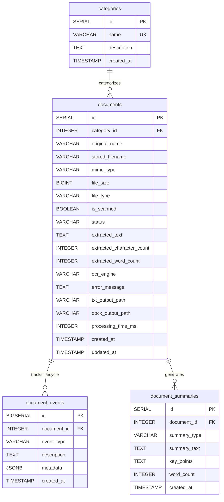

# Readify

Readify is a document-processing application that turns uploaded PDFs, Word documents, and images into searchable text. Users can review the extracted text, generate TXT or DOCX copies, download the results, and inspect a timeline of document activity.

## Features

- Upload PDF, DOCX, PNG, JPG, and JPEG files (maximum file size: 15 MB).
- Validate file type and file contents before saving an upload.
- Extract text from digital PDFs and DOCX files.
- Use OCR for scanned or mixed PDFs and image uploads.
- Preview extracted text and retry document processing when needed.
- Generate and download TXT and DOCX output files.
- Search documents by filename or extracted text content.
- Filter documents by status, file type, and category.
- Delete documents with cascading cleanup of database records and physical files.
- Keep document status, processing details, and activity history in PostgreSQL.
- Use a responsive, audio-console-inspired interface.

## Technology

| Area | Technology |
|---|---|
| Frontend | React 18, Vite, JavaScript, CSS |
| Backend | Node.js, Express 4 |
| Database | PostgreSQL, `pg` |
| PDF processing | `pdfjs-dist`, `@napi-rs/canvas` |
| DOCX processing | `mammoth`, `docx` |
| OCR | `tesseract.js` |
| Upload handling | `multer` |

## How the application works

1. A user uploads a supported document through the React interface.
2. The Express API validates the upload, stores the original file, and saves its metadata in PostgreSQL.
3. The processing endpoint extracts text. Digital PDF text is read directly; scanned PDF pages and images are processed with OCR; DOCX text is extracted with Mammoth.
4. Readify saves the extracted text, word and character counts, processing status, and related metadata.
5. The user can preview the text and request TXT or DOCX output.
6. Generated files are saved separately and can be downloaded from the document interface.
7. The activity history records events such as upload, processing start/completion/failure, and output generation.

## Project structure

```text
Readify/
├── server/
│   ├── db/                 # PostgreSQL connection, schema, and demonstration queries
│   ├── routes/             # Health, category, and document API routes
│   ├── services/           # Document processing and export logic
│   ├── utils/              # Shared backend utilities, including history logging
│   └── server.js           # Express server entry point
├── src/
│   ├── App.jsx             # Main application interface
│   ├── main.jsx             # React entry point
│   └── index.css            # Application styles
├── scripts/                # Verification and integration test scripts
├── uploads/                # Original uploaded files (created locally; Git-ignored)
├── outputs/                # Generated TXT/DOCX files (created locally; Git-ignored)
├── .env.example            # Environment variable template
├── .nvmrc                  # Required Node.js version
├── package.json
├── package-lock.json
├── vite.config.js
└── README.md
```

## Project setup

Follow these steps when setting up Readify on a new machine.

### 1. Install the prerequisites

- Install Git.
- Install Node.js using the version specified in `.nvmrc` (the development version is Node.js `24.22.2`). Using `nvm` is recommended.
- Install PostgreSQL and make sure its server is running.

With `nvm`, run these commands from the project directory:

```bash
nvm install
nvm use
node --version
npm --version
```

The Node version should match `.nvmrc`.

### 2. Get the project

Clone the repository and enter the project directory:

```bash
git clone https://github.com/samarthjaiswal369/Readify.git
cd Readify
```

If you already have the project folder, open a terminal in that folder instead.

### 3. Install dependencies

```bash
npm ci
```

### 4. Configure PostgreSQL

Create the database used by the project:

```bash
createdb readify_db
```

If the database already exists, do not create it again. If `createdb` cannot connect, check that PostgreSQL is running and that your local PostgreSQL user is configured correctly.

### 5. Configure environment variables

Create your local environment file:

```bash
cp .env.example .env
```

Open `.env` and fill in the connection details for your PostgreSQL installation. The template contains these variables:

```env
PORT=5001
NODE_ENV=development
DB_HOST=localhost
DB_PORT=5432
DB_NAME=readify_db
DB_USER=your_postgres_user
DB_PASSWORD=your_postgres_password
```

Use your own local PostgreSQL username and password. Do not commit `.env` or share database credentials. Keep `.env.example` as the safe template.

### 6. Set up the English OCR data file

The English Tesseract model file, `eng.traineddata`, is required for OCR. It is intentionally not tracked by Git because it is a large binary file.

Download the official English model from the [Tesseract OCR tessdata repository](https://github.com/tesseract-ocr/tessdata/blob/main/eng.traineddata). Place it at the location configured by the OCR service in `server/services/documentProcessor.js`. In the current development setup, this file is kept in the project root as `eng.traineddata`.

### 7. Initialize the database

Run the database initialization script:

```bash
npm run db:init
```

This creates the required database tables and indexes. It is safe to run when the schema has already been initialized.

### 8. Start the application

```bash
npm run dev
```

The development command starts the frontend and backend. By default:

- Frontend: `http://localhost:5173`
- Backend API: `http://localhost:5001`
- Health check: `http://localhost:5001/api/health`

Open the frontend URL in your browser. Keep the terminal running while using the application.

## API reference

| Method | Endpoint | Purpose |
|---|---|---|
| `GET` | `/api/health` | Check whether the API is running |
| `GET` | `/api/categories` | List document classification categories |
| `GET` | `/api/documents` | List stored documents (supports `?search=`, `?status=`, `?type=`, `?category_id=`) |
| `GET` | `/api/documents/stats` | Get document statistics |
| `GET` | `/api/documents/:id` | Get one document and its details |
| `GET` | `/api/documents/:id/history` | Get the document activity history |
| `POST` | `/api/documents/upload` | Upload a file (`multipart/form-data`, field name: `file`, optional `category_id`) |
| `POST` | `/api/documents/:id/process` | Process or retry a document |
| `POST` | `/api/documents/:id/convert` | Generate TXT and DOCX outputs |
| `GET` | `/api/documents/:id/download/txt` | Download the TXT output |
| `GET` | `/api/documents/:id/download/docx` | Download the DOCX output |
| `DELETE` | `/api/documents/:id` | Delete a document, its database records, and generated output files |

### Document Search and Filtering (`GET /api/documents`)

The document listing endpoint supports multi-criteria search and filtering through query parameters:

- `search` (string): Case-insensitive search matching against `original_name` or `extracted_text`.
- `status` (string): Filter by document status. Allowed values: `uploaded`, `processing`, `completed`, `failed`.
- `type` (string): Filter by document format. Allowed values: `pdf`, `docx`, `png`, `jpg`, `jpeg`.
- `category_id` (integer): Filter by assigned category identifier (positive integer).

Filters can be used independently or combined. When combined, all criteria are applied together with `AND`.

#### Example Request
```http
GET /api/documents?status=completed&type=pdf&category_id=1&search=invoice HTTP/1.1
Host: localhost:5001
```

#### Example Response (HTTP 200 OK)
```json
[
  {
    "id": 14,
    "category_id": 1,
    "original_name": "crud_invoice_alpha_8471.pdf",
    "file_size": 1024,
    "file_type": "pdf",
    "mime_type": "application/pdf",
    "is_scanned": false,
    "status": "completed",
    "ocr_engine": null,
    "has_txt_output": false,
    "has_docx_output": false,
    "extracted_character_count": 61,
    "created_at": "2026-11-13T11:25:00.000Z",
    "updated_at": "2026-11-13T11:25:00.000Z"
  }
]
```

### Document Deletion (`DELETE /api/documents/:id`)

Deletes the specified document:
1. Validates the provided ID parameter (must be a positive integer).
2. Verifies the document exists in PostgreSQL (returns HTTP 404 if not found).
3. Removes the document record from PostgreSQL. Foreign key cascade (`ON DELETE CASCADE`) automatically removes associated rows in `document_events` and `document_summaries`.
4. Safely removes the uploaded file from `uploads/` and generated output files (`.txt`, `.docx`) from `outputs/`. Directory traversal is prevented through path containment checks. Missing physical files are handled gracefully without errors.

#### Example Request
```http
DELETE /api/documents/14 HTTP/1.1
Host: localhost:5001
```

#### Example Response (HTTP 200 OK)
```json
{
  "message": "Document deleted successfully.",
  "deleted_document_id": 14,
  "database_deleted": true,
  "files_cleaned": true
}
```

## Database Architecture (Data Engineering)

### Entity-Relationship Diagram



### Relational Schema & Constraints

- **`categories`**: Document classifications.
  - Primary Key: `id SERIAL PRIMARY KEY`
  - Constraints: `name VARCHAR(100) NOT NULL UNIQUE`
- **`documents`**: Document storage, metadata, and processing state.
  - Primary Key: `id SERIAL PRIMARY KEY`
  - Foreign Key: `category_id INTEGER REFERENCES categories(id) ON DELETE SET NULL`
  - Constraints:
    - `chk_documents_status`: `CHECK (status IN ('uploaded', 'processing', 'completed', 'failed'))`
    - `chk_documents_file_size`: `CHECK (file_size > 0)`
- **`document_events`**: Immutable audit log of document lifecycle events.
  - Primary Key: `id BIGSERIAL PRIMARY KEY`
  - Foreign Key: `document_id INTEGER REFERENCES documents(id) ON DELETE CASCADE`
  - Constraints: `CHECK (event_type IN ('uploaded', 'processing_started', 'processing_completed', 'processing_failed', 'outputs_generated', 'conversion_failed'))`
- **`document_summaries`**: Extracted text summaries and key takeaways.
  - Primary Key: `id SERIAL PRIMARY KEY`
  - Foreign Key: `document_id INTEGER REFERENCES documents(id) ON DELETE CASCADE`
  - Constraints:
    - `chk_summary_word_count`: `CHECK (word_count >= 0)`
    - `chk_summary_type`: `CHECK (summary_type IN ('extractive', 'abstractive', 'bullet_points'))`

### Data Engineering SQL Demonstration

A dedicated SQL demonstration file is available at `server/db/demonstration_queries.sql`. It demonstrates:

1. **DML Operations**: `INSERT`, `SELECT`, `UPDATE`, and `DELETE`.
2. **Relational JOINs**:
   - `INNER JOIN`: Documents joined with categories and summaries.
   - `LEFT JOIN`: Categories joined with documents (preserving empty categories).
   - Multi-table `LEFT JOIN`: Documents, events, and summaries.
3. **Aggregation & Grouping**:
   - `GROUP BY` and `HAVING`: Document counts and byte sizes by category.
   - Aggregate functions: `COUNT(*)`, `SUM()`, `AVG()`, `MIN()`, and `MAX()`.
4. **Subqueries**:
   - Scalar subqueries: Comparing document size to overall average.
   - `IN` and `EXISTS` subqueries: Filtering categories by scanned documents.
   - Correlated subqueries: Group-relative calculations.
5. **Referential Integrity**: Automatic cascading deletion (`ON DELETE CASCADE`).

To execute and verify all 34 demonstration SQL operations:
```bash
node scripts/test-database-queries.js
```

Or execute directly through PostgreSQL:
```bash
psql -d readify_db -f server/db/demonstration_queries.sql
```

## Database and file storage

- PostgreSQL stores document metadata, categories, extracted text, summaries, processing information, and activity events.
- Original uploads are stored in `uploads/`.
- Generated TXT and DOCX files are stored in `outputs/`.
- The `uploads/` and `outputs/` folders are local runtime data and are ignored by Git. They are created by the application when needed.
- The `document_events` table stores the document activity timeline.

## Verification scripts

The `scripts/` directory contains focused verification scripts for document processing, export generation, processing API behaviour, processing safety, conversion API behaviour, document history, database demonstration queries, and CRUD search/deletion:

Run an individual script from the project root with Node.js. For example:

```bash
node scripts/test-crud-search.js
node scripts/test-database-queries.js
node scripts/verify-milestone4-workflow.js
node scripts/verify-document-processor.js
node scripts/test-document-exporter.js
node scripts/test-processing-api.js
node scripts/test-processing-safety.js
node scripts/test-conversion-api.js
node scripts/test-document-history.js
```

Some API and database checks require the local environment and PostgreSQL database to be configured first.

## Development history

The following is the project's development history, in chronological order:

| Commit | Date | What changed |
|---|---|---|
| `f9b782c` | 2026-10-28 | Set up the initial React/Vite frontend, Express server, PostgreSQL connection and schema, health/document routes, base interface, and environment/configuration files. |
| `20a1c3f` | 2026-10-28 | Added file uploads with size/type checks, file-content validation, UUID-based storage names, database metadata, and the upload interface. |
| `59c5116` | 2026-11-01 | Added text extraction for PDF and DOCX files, OCR for scanned PDFs and images, and document-processing verification. |
| `6c1f716` | 2026-11-01 | Added the document-processing API, persisted extracted text and processing metadata, and safeguards for duplicate processing and invalid stored files. |
| `7e585c7` | 2026-11-01 | Connected processing to the frontend, including process/retry actions, extracted-text preview, status display, and refresh behaviour. |
| `7abdcf5` | 2026-11-01 | Added TXT and DOCX export generation, temporary-file and atomic-write handling, empty-text validation, and exporter tests. |
| `59fa863` | 2026-11-03 | Added conversion and download API routes, safe output-file handling, output reuse/repair, and conversion safety checks. |
| `d71f0f3` | 2026-11-03 | Added the export interface, conversion/check-repair actions, TXT/DOCX download controls, and user notifications. |
| `482ce37` | 2026-11-03 | Improved responsive layout, constrained the application to the viewport, and made the document table scroll internally on smaller screens. |
| `f144def` | 2026-11-07 | Added document activity history, the `document_events` table, history API and logging utility, timeline interface, and history tests. |
| `887e6b6` | 2026-11-12 | Expanded PostgreSQL relational schema with categories and summaries, added constraints, and created 34-statement DE SQL demonstration suite. |
| `c51128d` | 2026-11-13 | Added multi-criteria document search, filter validation, cascade deletion endpoint, and safe physical file cleanup. |
| `33a7c12` | 2026-11-14 | Integrated search input, multi-filter patch bay, category dropdown, dynamic reset, and deletion UI with confirmation and cleanup alerts. |

## Implementation Roadmap

- [x] **Day 1**: Project Architecture, Express Backend, PostgreSQL Schema, and Audio-Console UI Foundation
- [x] **Day 2**: File Ingestion (Multer), Validation (PDF, DOCX, PNG, JPG, JPEG) & Document Tracking
- [x] **Day 3**: Document Processing Engine (pdfjs-dist, tesseract.js OCR, mammoth) & Text Extraction
- [x] **Day 4**: Output Generation (TXT, DOCX via docx library), Download Endpoints & Export Controls
- [x] **Day 5**: Document Activity History, Timeline Interface & History Tracking
- [x] **Milestone 1 (Data Engineering)**: Relational Schema Expansion (`categories`, `document_summaries`), Foreign Keys, Constraints, and 34-Statement SQL Demonstration Suite
- [x] **Milestone 2 (Backend API / ASD)**: Multi-Criteria Document Search & Filtering (`?search`, `?status`, `?type`, `?category_id`), Secure Deletion (`DELETE /api/documents/:id`), and Physical File Cleanup Error Detection
- [x] **Milestone 3 (Frontend Integration / ASD)**: Search Bar, Multi-Filter Rack, Dynamic Categories, Reset Controls, Delete Confirmation & Telemetry Cleanup Alerts
- [x] **Milestone 4 (Final Integration & Documentation)**: End-to-End Workflow Verification, API & Architecture Documentation, and Evaluation Readiness
- [x] **Milestone 5 (Unity / ISD Coursework)**: Readify: 2D Document Collector Game (Unity 2D, C# Physics, Spawners, Collision Handling, UI Manager)

## Milestone 5: Readify 2D Document Collector Game (Unity / ISD)

As part of the Interactive Systems Design (ISD) coursework, an interactive 2D top-down mini-game, **Readify: Document Collector**, is included in `unity/ReadifyDocumentCollector/`.

### Game Overview & Objectives
The player controls a collection unit across a 2D arena. The objective is to collect falling document pages while avoiding hazardous obstacles:
- **Documents**: Small white document pages falling from the top of the screen. Touching a document awards **+1 score**.
- **Obstacles**: Hazardous red obstacles falling from the top. Touching an obstacle costs **1 life** (player begins with 3 lives).
- **Game Over**: Reaching 0 lives displays the Game Over screen showing the final score and a Restart option.

### Controls
| Key / Input | Action |
|---|---|
| `W` / `Up Arrow` | Move Up |
| `S` / `Down Arrow` | Move Down |
| `A` / `Left Arrow` | Move Left |
| `D` / `Right Arrow` | Move Right |
| `Space` / `Return` | Start game from Title Screen |
| `R` / `Space` / `Return` | Restart game after Game Over |

### Unity Concepts Demonstrated
- **GameObject & Transform Hierarchy**: Composition of player, falling prefabs, spawners, cameras, and Canvas UI.
- **2D Physics & Collision Detection**: `Rigidbody2D`, `BoxCollider2D`, `CircleCollider2D`, and trigger collision detection using `OnTriggerEnter2D`.
- **C# Scripting Architecture**: Modular, beginner-friendly scripts without unnecessary abstractions:
  - `PlayerController.cs`: 2D movement and boundary clamping using `Input.GetAxisRaw`.
  - `FallingObject.cs`: Downward translation, off-screen cleanup, and trigger collision handling.
  - `DocumentSpawner.cs`: Timed random-interval document instantiations.
  - `ObstacleSpawner.cs`: Timed random-interval obstacle instantiations.
  - `GameManager.cs`: Singleton game manager coordinating score, lives, UI state transitions, and scene restarts.
- **Unity UI System**: Canvas Scaler (1080p reference), interactive HUD (Score and Lives), Start Title Panel, and Game Over Screen with Restart button.
- **Automated Scene Setup**: `Assets/Editor/SceneSetup.cs` with `[MenuItem("Readify/Setup Scene")]` allowing one-click automated scene generation and prefab wiring.

## Working with the team

1. Pull the latest `main` branch before starting new work.
2. Create a separate feature branch for each change, for example `feature/document-search`.
3. Keep changes focused and avoid editing another feature's files unless the team has coordinated it.
4. Test the affected feature before opening a pull request.
5. Never add `.env`, uploaded documents, generated outputs, or the OCR model binary to a commit.

## Current limitations and security note

- The API currently does not include user authentication or authorization. This is a current implementation limitation; the application is designed and run as a local development and demonstration console. Do not expose it publicly with real or sensitive documents until authentication, authorization, and deployment security are added.
- Uploaded and generated files are stored on the machine running the backend. They are not automatically synchronized between team members.
- OCR quality depends on the source document's image quality and the available language model.

## Repository

https://github.com/samarthjaiswal369/Readify
